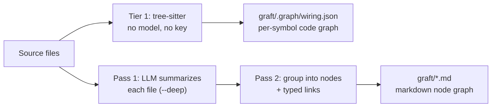

# graft

A code map for coding agents. graft parses your repo with tree-sitter into a graph of every symbol, its exact
`file:line` span and who calls what, keeps it in sync with your working tree, and answers from it: ranked code for a
task, a file's API, a symbol's callers and blast radius, an exhaustive grep grouped by symbol, a repo map. Claude Code,
Cursor, Codex and other agents use it through a CLI, an MCP server and hooks, instead of grepping and reading whole
files.

Everything structural runs on your machine with no model and no key. An optional `--deep` pass adds LLM-written
summaries through a provider key you choose.

## Highlights

- **GDScript (Godot `.gd`) is indexed**: `class_name` classes, inner classes, functions, signals, enums, constants
  and member vars, with calls, class references and `res://` imports (see [Supported languages](#supported-languages)).
- Installed and developed with pnpm, from source.
- No telemetry: nothing is sent anywhere (see [What runs where](#what-runs-where)).

## Contents

- [Install](#install) · [Quick start](#quick-start) · [How the graph gets built](#how-the-graph-gets-built) ·
  [Supported languages](#supported-languages) · [What's in a node](#whats-in-a-node) · [What runs where](#what-runs-where) ·
  [Agent integration](#agent-integration) · [CLI](#cli) · [Search & orient](#search--orient-graft-grep--graft-map) ·
  [Monorepos](#monorepos-submodules--multi-repo-folders) · [Visualize it](#visualize-it-graft-viz) ·
  [Development](#development) · [Attribution and license](#attribution-and-license)

## Install

graft is installed from source (the package is `@himanshu806/graft`; it is not on npm yet). Node 20 or newer and pnpm:

```bash
git clone https://github.com/Himasnhu-AT/graft.git && cd graft
pnpm install && pnpm run build
pnpm add -g file:$PWD        # puts `graft` on your PATH
```

The global install is a copy: after pulling changes, run `pnpm run build` and the same `pnpm add -g` again.

## Quick start

```bash
cd your-repo
graft init                           # pick the agents to wire; builds the graph
graft map                            # directory clusters, hubs, hotspots
graft ask "how are settlements streamed" --source
graft skeleton src/world/world_root.gd
graft callers GameState
graft grep "load_threaded_request"
```

---

## How the graph gets built

The graft map is built in layers. Tier 1 is tree-sitter: every symbol and call edge, no model, no key. `graft build --deep` adds two language-model passes on top:

1. **Read each file.** Every source file is summarized once into a short description of what it does.
2. **Group into nodes.** Those summaries are grouped into a curated set of nodes (subsystems, key files, and concepts) with typed links between them. The graft map chooses the right level of detail for you instead of making one node per file, so a big repo becomes a few dozen readable nodes.



Every pass is cached by content hash, the LLM ones and the tree-sitter parse alike. Re-running only touches the files that changed, so the second build is fast and cheap (on this repo, 312 files: about 5s cold, about 0.6s after one edited file or with nothing changed). `graft build --no-reuse` forces a cold re-parse.

That cheapness is what lets **every query refresh the graph before it answers**. A retrieval call stats the tree against the last build's fingerprint (about 50ms on this repo), and rebuilds only if something moved, so `ask`/`grep`/`callers`/`skeleton`/`map` describe the code as it is right now, including edits that are unsaved to git: uncommitted, unstaged, or staged all look the same to the graft map. Git determines the visible file set; freshness compares the working-tree bytes rather than commit or index state. The refresh is structural and `$0`; it never calls the LLM. Turn it off per-command with `--no-refresh`, or everywhere with `GRAFT_NO_REFRESH=1`.

Alongside the markdown graph, `graft build` builds `graft/.graph/wiring.json` (a per-symbol code graph) plus a per-file wiring card mirroring your source tree. Tier 1 is pure tree-sitter (every function, class, and call edge; deterministic, no model, no network), which is why plain `graft build` needs no key. The `--deep` pass adds a one-line summary and a crux excerpt per symbol, cached by body hash.

---

## Supported languages

The graft map parses with tree-sitter at two levels of fidelity, plus an optional
compiler-grade layer, all `$0` and deterministic (no model, no key):

- **Full-fidelity**: hand-written extractors with scope-aware, cross-file call
  and import resolution:
  **TypeScript / JavaScript** (incl. JSX & TSX), **Python**, **Go**, **Java**,
  **Kotlin**, **PHP**, **Swift** (classes, structs, enums, actors, protocols;
  extension members attach to the extended type), **R** (`.R`/`.r`: plain
  functions, S3/S4/R6 classes and methods, roxygen `@export`,
  `library()`/`source()` imports).

- **Broad**: symbols (functions, classes, methods, types, …) plus name-resolved
  call edges via a generic tree-sitter extractor, one grammar per language:
  **Rust, C, C++, C#, Ruby, Scala, Elixir, Solidity,
  Dart, Clojure, Nix, Lua, Gleam, Julia, PowerShell**, and **OCaml, Zig, GLSL** (symbols only for now, no call edges).
  **Bash** (`.sh`, `.bash`) also uses this tier for function symbols;
  Bash call edges and extensionless shell scripts are not yet supported.
  **GDScript** (Godot `.gd`): `class_name` classes, inner classes, functions,
  signals, enums, constants and member vars; calls, class references
  (`extends`, `Foo.new()`, type annotations) and `res://` `preload`/`load`/`extends`
  imports, matched against the folder that holds `project.godot`.

- **Single-file components**: **Vue** (`.vue`), **Svelte** (`.svelte`) and
  **Astro** (`.astro`). The wrapper grammar only locates the `<script>` block
  (and Astro's `---` frontmatter); the code inside goes through the
  full-fidelity TypeScript extractor, so a call from a component into a `.ts`
  module resolves to a real edge.

- **Compiler-grade edges (opt-in)**: `graft build --lsp` adds precise
  `lsp_resolved` call edges (member calls the static pass can't type) when a
  language server is on your `PATH`: **rust-analyzer** (Rust), **clangd** (C/C++),
  **gopls** (Go), **pyright** (Python), **typescript-language-server** (TS/JS).
  Mixed-language repos use each applicable installed server, restricted to its
  own files. It's best-effort: a missing or failed server leaves those languages
  on the AST graph while the other servers still run.

Twenty-nine languages, plus Vue, Svelte and Astro single-file components. A file whose language isn't listed is skipped, not
indexed. Adding a broad-tier language is a small contribution; see
[CREDITS.md](CREDITS.md) for the folks who added the current set.

---

## What's in a node

A node is a single markdown file. Most code maps stop at an address: this thing lives in that file, on that line. That tells an agent where to look, not what it will find, so it still has to open the source and read. A graft map node holds the meaning inline, so the agent learns what it needs up front and opens the file only when it wants more.

Each node holds:

| Part | What it holds |
|---|---|
| **Summary** | A plain-English explanation of what the code does, written by the model and cached. It is there whether or not the code was ever documented, and it is regenerated when the source changes. |
| **Crux** | The handful of lines that actually carry the logic: the guard, the skip condition, the state change. Lifted straight from the source and stored inline, so the agent sees *how* it works, not just what. |
| **Sources** | The exact files the node is built from, each tracked by a content hash, so the graft map can tell precisely when a node has gone stale. |
| **Links** | Typed connections to other nodes (`depends_on`, `part_of`, `uses`, `implements`, `produces`), written as `[[wikilinks]]` your agent can follow. |
| **Your text** | Anything you write below the generated block. It is preserved across regenerations, so your own context is never overwritten. |

That is three depths in one file: the summary says *what* the code does, the crux shows *how*, and the sources point to the rest if the agent needs it. A plain index makes it read a whole file to learn one thing. A graft map node hands it the answer inline, and the follow-up read often never happens.

The crux is stored as the code itself, not as a line range, on purpose. Line numbers drift whenever unrelated code above them shifts, but the lines that matter do not. Keeping the text, not the numbers, means the crux stays correct even as the file around it moves.

_Summary, sources, links, and your text ship today in markdown nodes. The crux ships per-symbol in the code graph (`graft build --deep`); inlining it into markdown nodes is next._

---

## What runs where

- **On your machine, no key, no network:** the structural code graph. `graft build` (wiring graph + per-file cards), `graft build --check`, `graft ask`, learnings and `graft check` are deterministic. They never call a model.
- **Through your provider key:** the LLM-written parts. `graft build --deep` adds the concept nodes (file summaries + node synthesis) and the per-symbol summaries and cruxes. The graft map is vendor-neutral: set `GRAFT_PROVIDER` (`openai` for any OpenAI-compatible endpoint, `anthropic` for the native API, or `litellm` / `orcarouter` for a gateway that speaks the OpenAI-compatible format), your `GRAFT_API_KEY`, `GRAFT_MODEL`, and, for the `openai` wire format, `GRAFT_BASE_URL` to point at OpenRouter, Fireworks, Groq, a LiteLLM proxy, a local server, or OpenAI itself. Or pass `--provider/--model/--api-key/--base-url` on the command line. (`OPENROUTER_API_KEY` still works as a deprecated fallback, and `ORCAROUTER_API_KEY` as a second one.)
- **No usage telemetry.** The telemetry module from the original project is still in the code (`graft telemetry status` and `debug` work), but no key or endpoint is ever built in, so nothing is sent. A daily npm version check is the one remaining network call; `DO_NOT_TRACK=1` turns it off.

Settings keep their `GRAFT_` names. See [`.env.example`](.env.example) for the full list (model, base URL, graph directory).

---

## Agent integration

One command wires graft into the coding agents you use (after [installing it](#install)):

```bash
graft init
# detects your agents and writes each one's native instruction file;
# Claude Code additionally gets the live statusline + hooks below
```

On a terminal, `init` shows you every agent it knows about, flags the ones it detected (via their config directories), lists the exact files each would write, and wires only the ones you select. Claude Code is pre-selected; nothing else is. Selected agents get a marker-fenced graft section in their shared instruction file (`AGENTS.md` for Codex, OpenCode and other CLIs that read it, `GEMINI.md`, `.github/copilot-instructions.md`), or a wholly-owned rule or skill file for the agents that use one, such as `.claude/skills/trail/SKILL.md` and `.cursor/rules/trail.mdc`. Claude Code is in the second group: `init` writes its own skill file and never touches your `CLAUDE.md`. For selected agents, re-running updates only graft's own section (or replaces the owned file) and never touches the rest of your content.

**Selection replaces the previous set; it is not additive.** `init` removes graft's wiring for unselected agents, including their **user-level files** by default. Those removals affect every repo you use with that agent, not just this one. Pass every agent you want to keep (for example, `graft init --agents claude hermes`), or add `--no-global` to leave user-level files alone while changing this repo's wiring.

In Claude Code, the committed skill file is also how a teammate without graft installed gets your learnings: it tells their agent where `.trail/learnings/` is, to read it before exploring, and to tell them once how to install the rest.

With no TTY to prompt on (CI, a Dockerfile, a piped shell), `init` writes **nothing** and prints the command to run instead. Pass `--agents <ids>` or `--yes` to make a scripted run explicit.

| Flag | Effect |
|---|---|
| `--agents <ids...>` | wire these and remove graft's wiring for all unlisted agents, including user-level files (unless `--no-global`); pass every agent you use; no prompt; ids: `agents`, `adal`, `cursor`, `gemini`, `grok`, `hermes`, `antigravity`, `copilot`, `kiro`, `windsurf`, `claude` |
| `--yes`, `-y` | skip the prompt and wire every **detected** agent |
| `--dry-run` | print the agent wiring `init` would write, then exit without writing |
| `--just-me` | graft just for you in this repo: git sees none of it and your learnings stay in `~/.trail` |
| `--team` | share graft with your team: commit `.trail/` and `.claude/settings.json` once |
| `--all-agents` | write instruction files for every known agent, detected or not |
| `--no-agents` | Claude Code wiring only; skip other agents |
| `--list-agents` | print the known agent ids and exit |
| `--no-mcp` | skip MCP registration for agents other than Claude Code |
| `--no-hooks` | skip hook installation for agents other than Claude Code |
| `--no-statusline` | skip writing Claude Code `statusLine` (same as `GRAFT_NO_STATUSLINE=1`) |
| `--no-global` | skip writes and removals outside this repo (the user-level files below) |

#### Writes outside the repo

Some agents also get **user-level** files, so the wiring follows you into worktrees and folders the repo's files don't reach:

| Agent | Path | What changes |
|---|---|---|
| Claude Code | `~/.claude/settings.json` | `SessionStart`, `UserPromptSubmit`, `PreToolUse` (on `Bash`), `PostToolUse` and `Stop` hooks |
| Claude Code | `~/.claude/helpers/graft-hooks.cjs` | the hooks shim they call |
| Claude Code | `~/.claude.json` | the `trail` MCP server |
| Codex (`agents`), when `~/.codex/` exists | `~/.codex/config.toml` | the `trail` MCP server |
| Codex | `~/.codex/hooks.json` | the same five hook events, matching `apply_patch\|Write\|Edit\|MultiEdit` after edits |
| Codex | `~/.codex/hooks/graft/graft-hooks.cjs` | the hooks shim |
| Pi | `~/.pi/agent/extensions/graft-hooks.ts` | the same four hook events as an extension (`session_start`, `before_agent_start`, `tool_result`, `agent_end`) |
| Pi | `~/.pi/hooks/graft/graft-hooks.cjs` | the hooks shim it spawns |
| Antigravity | `~/.gemini/config/mcp_config.json` | the `trail` MCP server |
| Antigravity | `~/.gemini/skills/trail/SKILL.md` | its skill file |

These apply to **every** repo you open with that agent, not just this one. The picker labels them `machine-wide`, `--dry-run` lists them in their own section, and `--no-global` skips them all while still wiring the repo's own files.

### MCP server

`graft init` also registers the graft MCP server with agents that support it, so these six tools appear natively, no shell required. Claude Code gets this too: `graft init` writes the server into the project's `.mcp.json` (restart Claude Code to load it). Run it by hand with `graft mcp [dir]`.

| Tool | Takes | What it's for |
|---|---|---|
| `graft_find_code` | a question | Ranked nodes with file:line, source inlined; usually the full answer, no follow-up read needed. |
| `graft_file_api` | a file path | Every signature in that file, no bodies: the API surface for a tenth of the tokens. |
| `graft_trace_calls` | a symbol | Who depends on it, or what it depends on with `direction: out`, N levels deep for blast radius. |
| `graft_find_all` | a regex | Every hit, grouped by enclosing symbol, ranked by how coupled that symbol is. |
| `graft_repo_map` | nothing | A first look at an unfamiliar repo: directory clusters, hubs, hotspots. |
| `graft_check_freshness` | nothing | Whether the local graph has drifted from the code. |

The same server also answers the `trail_*` names of these tools. Register it by hand if your agent needs it explicit:

```json
{ "mcpServers": { "graft": { "command": "graft", "args": ["mcp"] } } }
```

Where a CLI agent supports user-level `hooks.json`, as Codex does, `init` also installs graft's hooks there: session start, context with each prompt, blast radius and a `$0` graph re-sync after edits, and the end-of-turn sync (skip with `--no-hooks`).

### Claude Code (deep integration)

When Claude Code is selected (it is by default), it gets more than the skill file above. From then on, any Claude Code session opened in the repo gets:

- **a live statusline**: the folder you're in, the graft map's size, how many learnings the repo has, and a `⚠ N stale` warning when the code has moved ahead of the map
- **auto-sync**: every query brings the graph up to date first, so an answer always describes the code as it is right now, uncommitted edits included. A query refreshes only what it reads; the markdown under `graft/` is refreshed by the background rebuild at the end of a turn that touched code. Both are structural and `$0`; auto-sync never calls the LLM on its own
- **context on tap**: each prompt pulls in the matching nodes and the learnings left on that code; editing a file surfaces what depends on it ("blast radius"); new sessions start with the repo map and how many learnings there are
- **learnings when you ask**: say "save this as a learning" and Claude saves one; it never asks to on its own
- **overlap with teammates**: at session start, and every few minutes, it reads what teammates' open branches change, skipping any already merged or closed; when Claude edits a function or constant one of them also changes, it reads their change and tells you whether the two clash

<p align="center">
  
  <br/><sub>edit a file → blast radius appears inline → graph auto-resyncs → confirmed in the viewer</sub>
</p>

`graft init` is idempotent and never clobbers your existing `.claude/settings.json`: it merges its blocks and leaves the rest alone. A `statusLine` that is not graft's, in `~/.claude/settings.json` or the repo's own settings, is kept, and graft adds its own only where you have none; re-running `init` refreshes graft's own helper command if it is already installed. Pass `--no-statusline` (or `GRAFT_NO_STATUSLINE=1`) to skip installing one at all. Want the LLM summaries too? Run `graft build --deep` (with a key) whenever you like; auto-sync will never do it for you.

---

## CLI

`graft --help` lists the commands in four groups.

```bash
# find code · your agent runs these
graft ask "<task>" [dir]             # the matching code and learnings: ranked nodes + exact file:line (no LLM, no key)
graft ask "<task>" --json            # machine-readable result
graft ask "<task>" --in <scope>      # narrow to one sub-project of a monorepo/multi-repo folder (see below)

graft grep "<regex>" [dir]           # exhaustive regex search over indexed files, grouped by enclosing symbol (no LLM, no key)
graft grep "<regex>" --in <path>     # narrow to files at or under this path prefix
graft grep "<regex>" -i --fixed      # case-insensitive; treat the pattern as a literal string, not a regex

graft skeleton <file> [dir]          # every signature in one file, no bodies: the API surface for ~1/10th the tokens (no LLM, no key)

graft callers <symbol> [dir]         # who calls/references/imports/implements/extends a symbol (no LLM, no key)
graft callers <symbol> --direction out  # the reverse: what the symbol itself calls/references
graft callers <symbol> -d N          # walk transitively out to depth N: full blast radius

graft map [dir]                      # token-budgeted repo orientation: dir clusters, hubs, hotspots (no LLM, no key)
graft map --max-dirs N               # raise/lower the number of directories shown

# ask / skeleton / callers / grep / map / blast all refresh the graph first if the working tree moved:
#   --no-refresh                     # answer from the graph exactly as it is on disk
#   GRAFT_NO_REFRESH=1               # same, for every command
#   GRAFT_REFRESH=hash               # hash every file instead of trusting size+mtime

# learnings
graft note --title "<about>" [dir]   # save a learning: what this session decided, tried and ruled out (the text on stdin)
graft note --always-follow           # mark it always follow: your agent won't go against it, even if asked
graft note --personal                # about your own setup, not the code: keep it in ~/.trail, out of the repo
graft check [dir]                    # check your branch's diff against the repo's learnings, yours and your skills (exit 1 on a conflict)
graft check --base origin/main       # compare against this base instead of origin's default branch
graft team [dir]                     # what the team learned this week, who's working on what, and where work overlaps
graft skills [--json]                # your skills: scope, status, uses; held ones; jobs graft is counting; offers
graft skills off | on [<name>]       # skills are on by default: turn them off, or back on (only you, in your own terminal); or one skill
graft skills offers on | off [--here] # skill offers everywhere, or just this repo (only you turn them on)
graft skills show <name>             # print a skill and its status
graft skills keep <name>             # keep a skill graft held because nobody said yes (only you)
graft forget <name>                  # forget a skill; graft skills restore <name> brings it back

# setup
graft init [dir]                     # pick which agents to wire (prompts on a terminal; writes nothing until you choose)
graft init --dry-run                 # list the agent wiring it would write, then exit
graft init --agents cursor kiro      # replace the selection; remove other agents' wiring, including user-level files
                                     # pass every agent you use; --no-global leaves user-level files alone
graft init --yes                     # no prompt; wire every detected agent
graft init --no-global               # skip writes and removals outside this repo (~/.claude, ~/.claude.json, ~/.codex, ~/.gemini)
graft init --no-statusline           # skip Claude Code statusLine (same as GRAFT_NO_STATUSLINE=1)
graft init --no-build                # wire the files only; don't build the graph
graft init --all-agents              # wire every known agent, detected or not
graft init --list-agents             # list known agent ids and exit

graft build [dir]                    # build the graft map in graft/: wiring graph + per-file cards (no LLM, no key)
graft build --deep                   # add the LLM layer: concept nodes + per-symbol summary/crux (cached)
graft build --check                  # build nothing: fail (exit 1) if graft/ has drifted from the code, for CI
graft build -e .ts .py               # only index these extensions (also limits --deep summaries)
graft build --no-reuse               # re-parse every file instead of replaying unchanged ones from cache
graft build --follow-submodules      # include initialized submodules; persist the choice for builds + MCP refresh
graft build --no-follow-submodules   # exclude submodules again and persist that choice (the default)
graft build --follow-nested-repos    # include nested git clones the index doesn't track; persist the choice
graft build --no-follow-nested-repos # exclude nested clones again and persist that choice (the default)

graft status [dir]                   # the graft map, learnings and tokens saved, on one screen
                                     # no `upgrade` here: it would install the old npm package over this
                                     # build. Pull and rebuild from source instead (see Install)
graft uninstall [dir]                # remove every file and config entry it wrote here (the inverse of init)
graft uninstall -y                   # actually remove (without -y it prints what it would remove and exits)
graft uninstall --keep-cache         # wiring only; leave graft/ and the .gitignore entry
graft uninstall --no-global          # leave out-of-repo files alone (~/.claude, ~/.claude.json, ~/.codex, ~/.gemini)
graft telemetry [status|enable|disable|debug]   # anonymous usage stats; debug prints exactly what would be sent

# CI
graft blast [dir]                    # blast radius of a diff: what depends on the lines this change touched (no LLM, no key)
graft blast --base origin/main       # diff against the merge base with HEAD (what a PR job runs)
graft blast --format markdown        # a PR comment: the areas a change can reach, per-symbol detail collapsed under it
graft blast --base origin/main --name  # name those areas with one cached LLM call, instead of a full --deep build
graft blast --export-viz site/       # also write the interactive page for this radius (what a PR comment links to)
graft blast --no-owners              # skip "who to tag" (by default, git history names the people behind each area)
graft blast --depth all --format json  # the full transitive closure, machine-readable

# not listed in --help, still there
graft viz [dir]                      # see the graph: serves an interactive viewer on localhost
graft viz --export site/ --title "PR #12"  # one self-contained index.html for CI, GitHub Pages, or a build artifact
graft mcp [dir]                      # run the MCP server by hand

# global
graft --dir <path>                   # use a context dir other than <repo>/graft
graft --version, -v                  # print the installed version and exit
```

Extension selections also apply to automatic refreshes. Run an explicit
`graft build` without `-e` to index all supported extensions again.

Method calls resolve through the receiver's type, using constructor assignments
(`self.router = APIRouter()`) and type annotations, not just the call-site
name, so `callers`/`grep --in` return calls bound to the right
type on method-heavy code, not every method anywhere with that name.

## Search & orient (`graft grep` / `graft map`)

`graft grep "<regex>"` is exhaustive over every indexed file and groups hits
by enclosing symbol, ranked by the same in-edge coupling `graft map` uses.
It's built for "every occurrence of this pattern" tasks where `graft ask`'s
ranked top-N isn't enough:

```
"NEEDLE" — 2 hits in 2 symbols across 1 files (searched 1 indexed files)

heavilyCalled · function · src/a.ts:L1-L3 · 3 in-edges
  L2: console.log("NEEDLE hit in heavilyCalled");

rarelyCalled · function · src/a.ts:L4-L6 · 0 in-edges
  L5: console.log("NEEDLE hit in rarelyCalled");
```

`graft map` is a token-budgeted first look at a repo: directory clusters
with file/symbol counts, each dir's local hubs, and the global hotspots,
all ranked by in-degree, no LLM, no key:

```
repo map — 313 files · 2349 symbols · 8148 edges · javascript, typescript

src/                157 files · 1804 symbols   hubs: wiringPath (write.ts, 48←), cmd (brand.ts, 45←), buildGraph (build.ts, 39←)
test/               144 files · 467 symbols   hubs: tmpRepo (helpers.ts, 46←), fetch (app-identity.test.ts, 7←), fakeProviders (helpers.ts, 5←)
viewer/             5 files · 71 symbols   hubs: $ (main.ts, 9←), cvar (data.ts, 6←), activeGraph (main.ts, 5←)
scripts/            7 files · 7 symbols   hubs: bump (graph-quality.mjs, 1←), defaultTranscriptDir (tally-audit.mjs, 1←), flush (tally-audit.mjs, 1←)

hotspots: wiringPath · function · src/graph/write.ts:L20-L22 · 48←  tmpRepo · function · test/helpers.ts:L30-L32 · 46←  cmd · function · src/brand.ts:L63-L70 · 45←  ...
```

## Monorepos, submodules & multi-repo folders

The graft map supports these layouts:

- **A monorepo with one `.git`** (a `pnpm-workspace.yaml`/`package.json`
  `workspaces`, or per-package `go.mod`/`pyproject.toml`/`Cargo.toml`):
  `graft build` discovers each sub-project as a ranking scope. `ask`/`map`
  rank every scope on its own terms and fuse the results, so the biggest
  sub-project can't drown a small one; hits carry `[scope/]` labels, and
  `graft map` groups its directory clusters by scope first.
- **A Git superproject with initialized submodules**: submodules stay excluded
  by default. Run `graft build --follow-submodules` to fold initialized gitlinks
  into one graph, prefixing child paths (for example,
  `deps/parser/src/index.ts`) while honoring each submodule's own Git ignore
  rules. Visible untracked files are included too; uninitialized submodules
  remain absent until `git submodule update --init` checks them out. The choice
  is saved in `.graft/config.json`, so later no-flag builds and MCP automatic
  refreshes behave the same way. Run `graft build --no-follow-submodules` to
  restore and persist the default boundary.
- **A git repo with other repos cloned inside it** (no gitlink, no index entry): the shape multi-repo manifest tools like `west`, `repo`, `gclient` and `tsrc` check dependencies out into, and the shape you get by cloning an upstream into the tree to patch it locally. `--follow-submodules` cannot reach these: they have no `160000` index entry to follow. Run `graft build --follow-nested-repos` to fold them into one graph, prefixing child paths (for example, `external/parser/src/index.ts`) while honoring each clone's own Git ignore rules. A clone at a git-ignored path stays absent, since Git never reports it. The choice is saved in `.graft/config.json` and is independent of `--follow-submodules`; neither flag implies the other. Run `graft build --no-follow-nested-repos` to restore and persist the default boundary. Prefer this over the multi-repo split below when the nested repos import from each other and you want those edges in one graph; prefer the split when you want each repo scored and refreshed on its own.
- **A folder of separate git repos** (no `.git` at the top): `graft build`
  auto-splits: each child gets its own (git-ignored) `graft/`, and the parent
  gets a `graft/workspace.json` index. Queries from the parent federate across
  every child, always labeled `<child>/`. Run `graft build` inside a child to
  work on just that repo.

In every layout, narrow to one sub-project with `graft ask "<task>" --in <scope>/`
once you know where you're working.

`graft init` at the parent of a multi-repo folder wires **every child repo too**,
not just the parent. An agent session opens at a repo root and reads its
instruction files from there, so each child needs its own. A session started in
the parent gets the federated view; one started in a child sees that repo alone.

Commands also find the graph from a subdirectory: with no `[dir]` argument they
walk up to the nearest `graft/`, so `graft ask` works from `src/deep/inside/`
without a `cd` to the repo root.

## Visualize it (`graft viz`)

`graft viz` opens a local, interactive view of both graphs. No install, no dev
server; the viewer ships prebuilt inside the package.

<p align="center">
  
  <br/><sub>search → jump to a node → dependency graph lights up</sub>
</p>

- **Context** tab: the architecture graph from `graft/*.md`. Nodes colored by
  type, sized by connectedness.
- **Code** tab: the per-symbol graph from `graft/.graph/wiring.json` (run `graft build` first).
- **Outline** tab: the file → class → method hierarchy as a collapsible tree.

Edges speak the code's language. Every link is one of a closed set of verbs, each
answering a question someone building or reviewing code actually asks:

| Verb | The question it answers |
|---|---|
| `part_of` / `contains` | where does this live? |
| `uses` / `calls` / `imports` / `depends_on` | what breaks if I change this? |
| `produces` | where does this output come from? |
| `configures` | what changes its behavior without a code change? |
| `validates` | what checks or judges this? (tests, drift checks, scoring) |
| `extends` / `implements` | what contract must this honor? |
| `references` | what names this without calling it? (drawn as faint dots) |

Select a node and its edges take on direction: **amber = what it depends on,
indigo = what depends on it**, with the verb written on each highlighted edge.
Chips above the canvas filter by verb; edges the parser resolved exactly draw
solid, while edges matched by name alone, or inferred by the model, draw dashed. The viewer live-reloads when `graft/`
changes on disk. Older graphs with vague verbs (`influences`, `supports`) are
normalized on load, so no regeneration is needed.

---

## Development

```bash
git clone https://github.com/Himasnhu-AT/graft.git && cd graft
pnpm install
pnpm run build
pnpm test

pnpm run cli build --deep .        # run the CLI from source
```

---

## Attribution and license

graft is MIT-licensed; see [LICENSE](LICENSE). The original copyright notice is kept as is.

graft is derived from [trailhq/Trail-Code](https://github.com/trailhq/Trail-Code)
(published as `@trailhq/trail-code`, earlier as graft, `@nanonets/graft`), and continues from its commit
[`d8a59c17`](https://github.com/trailhq/Trail-Code/commit/d8a59c17cf58abdbbaa2ba310c103b2fb38ca802)
("Get overlap warnings ready to go live (#738)", version 0.30.5). Everything up to that commit is the work of the
upstream authors and contributors, credited in the git history and in [CREDITS.md](CREDITS.md).
